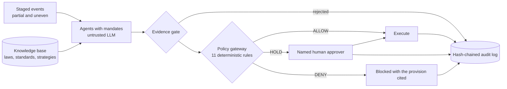

<div align="center">

# MARSA

### AI that acts at network speed, without acting beyond the law

Policy-gated multi-agent crisis response for telecom networks

[](https://aiforgood.itu.int/event/ai-for-good-sandbox-hackathon-united-arab-emirates/)
[](https://www.itu.int/rec/T-REC-Y.3172/en)
[](#results)
[](tests/test_core.py)
[](#quick-start)
[](LICENSE)

[The problem](#the-problem) · [How it works](#how-it-works) · [The exercise](#the-exercise) · [Policy gaps](#policy-gaps-found) · [Quick start](#quick-start) · [Results](#results)

</div>

---

## The problem

Two subsea cables fail at peak demand. Hospitals lose their teleradiology links. An AI planner finds a fast route, but it crosses a neighbouring state.

**Is that legal?** Health-data law bars transfer outside the State, yet it does not say whether encrypted transit through a foreign network counts. Global resilience guidance recommends rerouting, and the 2026 ITU/ICPC advisory report never mentions privacy or personal data.

Network AI can already move traffic in minutes. What it lacks is any idea of what it is allowed to do. MARSA gives it that boundary.

> **Agents propose. Deterministic code decides. People approve whatever the law leaves open.**

## How it works



| Layer | What it does | Why it matters |
|---|---|---|
| **Knowledge base** | Hybrid dense and BM25 retrieval over 87 documents, with legal force, jurisdiction and page or article locators | Binding law, soft law and commentary are never confused |
| **Agents** | Simulated operator, regulator, health, data-protection, crisis and global-policy roles, each with its own inbox | Information is incomplete and arrives at different times |
| **Evidence gate** | A claim survives only with a verbatim sentence from a source the agent retrieved, and may not assert an unconfirmed cause | Invented law is removed before anyone sees it |
| **Policy gateway** | Rules return `ALLOW`, `HOLD` or `DENY` with the provision and approver. Unknown actions fail safe to `HOLD` | Model output can never reach the network directly |
| **Audit log** | SHA-256 chain of prompts, retrievals, rejections, decisions and approvals | Changing one line breaks every line after it |

### A verdict looks like this

```json
{
  "action": "A3",
  "verdict": "HOLD",
  "legal_status": "ambiguous",
  "rules": ["R-HEALTH-TRANSIT", "R-PERSONAL-TRANSIT"],
  "approver": ["data_office", "health_authority", "regulator"],
  "gaps": ["G1"]
}
```

## The exercise

A fictional crisis in eight stages, plus one judge's event. The network is synthetic and institutions are simulated roles.

| Time | Event | Proposed action | Verdict |
|---|---|---|---|
| T+12 | Second cable degrades | Move general traffic onto domestic-landing capacity | 🟢 `ALLOW` |
| T+12 | Capacity falls to 305 Gbps | Protect emergency and clinical traffic | 🟡 `HOLD`, law silent |
| T+40 | Only route crosses a neighbouring state | Send encrypted clinical traffic through it | 🟡 `HOLD`, law ambiguous |
| T+40 | Same | Fail hospital AI over to a foreign cloud | 🔴 `DENY` |
| T+55 | Social media claims sabotage | Publish sabotage as the cause | 🔴 `DENY` |
| T+70 | Enterprises ask who ranked their traffic | Extend slowing to enterprise traffic | 🟡 `HOLD`, then rejected by a human |
| T+75 | **Judge's event:** vendor offers deep packet inspection | Deploy a content-reading classifier | 🔴 `DENY` |
| T+90 | Repair ship and foreign operator need action | Share telemetry, request clearance | 🟡 `HOLD` |
| T+120 | AI misranked a payments service | Roll back the classifier | 🟢 `ALLOW` |

The last row is deliberate. MARSA shows what happens when the AI itself is wrong, and containment comes from the rollback path, not from the model.

## Policy gaps found

Gaps are stated at domain level, with the UAE as the worked example and global practice as the comparison.

| # | Gap | Type | Global example | Proposed fix |
|---|---|---|---|---|
| **G1** | Is crisis transit a transfer under data-localisation law? | Legislative | EDPB Guidelines 05/2021 | Crisis-transit carve-out: encrypted, unstored, time-limited, reported |
| **G2** | No explicit emergency traffic-priority power in the text reviewed | Unclear responsibility | India Telecom Act s.20, US TSP, EU 2015/2120 Art. 3, UK s.132 | Pre-register priority classes and name who activates them |
| **G3** | Y.3172 stops at operator policy | Standards | Y.3173 levels | [Regulatory-policy function for the P node](docs/y3172_regulatory_policy_function.md) |
| **G4** | Who answers for AI acting on critical networks? | Legislative | EU AI Act Annex III and Art. 14 | Named accountability, override, retained logs |
| **G5** | No visible single contact across repair, customs and telecom | Coordination | ITU/ICPC advisory report, Singapore | Publish a crisis contact and track time-to-permit |

Silence is measured, not assumed. [`marsa/absence.py`](marsa/absence.py) counts terms in each document. For example, Y.3172 has zero occurrences of "regulat", "legal" and "oversight".

## Aligned with ITU-T Y.3172

| Node | MARSA |
|---|---|
| **SRC** | Telemetry and event feeds, with service tags and no payload |
| **C** | In-country collectors |
| **PP** | Normalisation, identifier removal, class tagging |
| **M** | Utilisation forecast, route planner, agent LLM |
| **P** | Evidence gate, policy gateway, human approval |
| **D** | Approved actions with a human-set time limit and rollback |
| **SINK** | Network controllers, crisis console, after-action report |

## Quick start

```bash
git clone https://github.com/Strong-Ari/marsa && cd marsa
pip install -r requirements.txt

python -m marsa.validate        # check every legal citation verbatim
python -m pytest -q tests       # run the tests
python -m marsa.run             # run the exercise, no model needed
python -m marsa.run --inject J1 --out runs/injected    # add the judge's event
```

Use a real model:

```bash
python -m marsa.run --backend "gguf:/path/to/model.gguf"
python -m marsa.run --backend "openai:http://localhost:11434/v1|qwen2.5:14b"   # Ollama or any compatible endpoint
```

Reproduce the evaluation and build the Incident Room page:

```bash
PYTHONPATH=. python eval/run_eval.py
python -m marsa.absence
python -m marsa.viewer runs/injected
```

## Results

| Measure | Result |
|---|---|
| Legal citations in rules and gaps, found verbatim | **34 / 34** |
| Retrieval hit@5 on 32 queries | **0.938**, against 0.875 for dense search alone |
| Retrieval mean reciprocal rank | **0.901**, against 0.735 for dense search alone |
| Arabic queries answered from English sources, hit@5 | **4 / 4** |
| Tampered quotes rejected by the evidence gate | **500 / 500** |
| Genuine quotes accepted | **500 / 500** |
| Gateway decisions identical with and without a model | **10 / 10** |

The retrieval benchmark is small and was also used for tuning.

## Repository

```text
marsa/       agents, evidence gate, gateway, audit log, retrieval, network model
rules/       policy rules and gap catalogue, with citations
scenarios/   crisis exercise and judge's event
kb/          indexed knowledge base and source inventory
corpus/      manifest and curated extracts
eval/        retrieval, gate and agent benchmarks
docs/        Y.3172 proposal, verdict schema, demo script
viewer/      self-contained Incident Room page
tests/       gateway, audit and evidence tests
```

## Limits

- The network, traffic figures and scenario are synthetic. Institutions are simulated and do not represent any real body.
- The UAE Telecom Law text is a 2005 English edition, later amended, and the Arabic text prevails. Health and data laws appear as short verbatim extracts.
- The evidence gate proves a quote exists, not that it is relevant, so agent advice is shown as unverified.
- A zero term count covers indexed text only and does not rule out unpublished instruments.
- This is a research prototype and not legal advice.

## Team

**HeriTech**, Côte d'Ivoire

- Blé Ariel Josaphat, team leader
- Echicoua Ando Aquilas
- Kamagaté Ladji Lama

## License

[MIT](LICENSE). Source documents remain under their own terms; see `kb/inventory.json` for origins.
